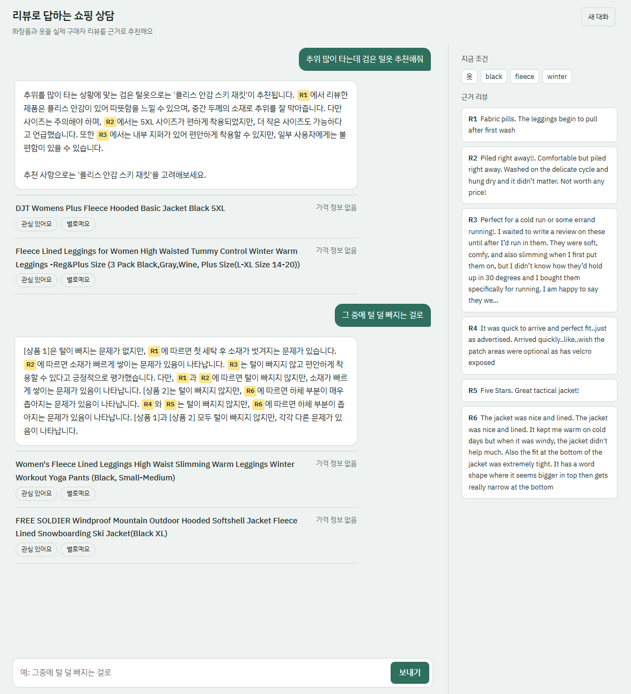
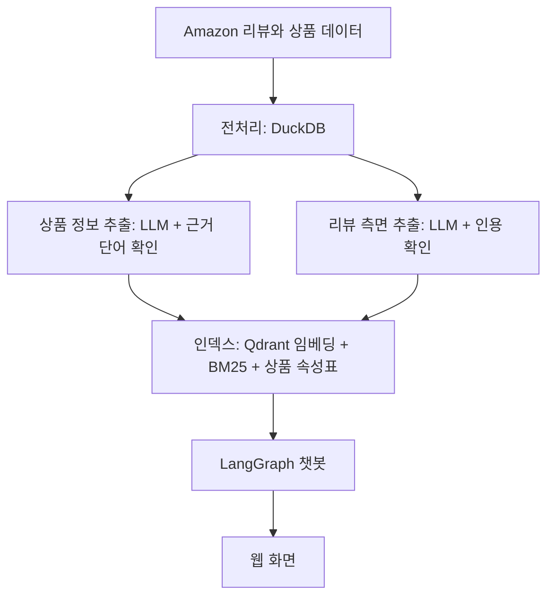
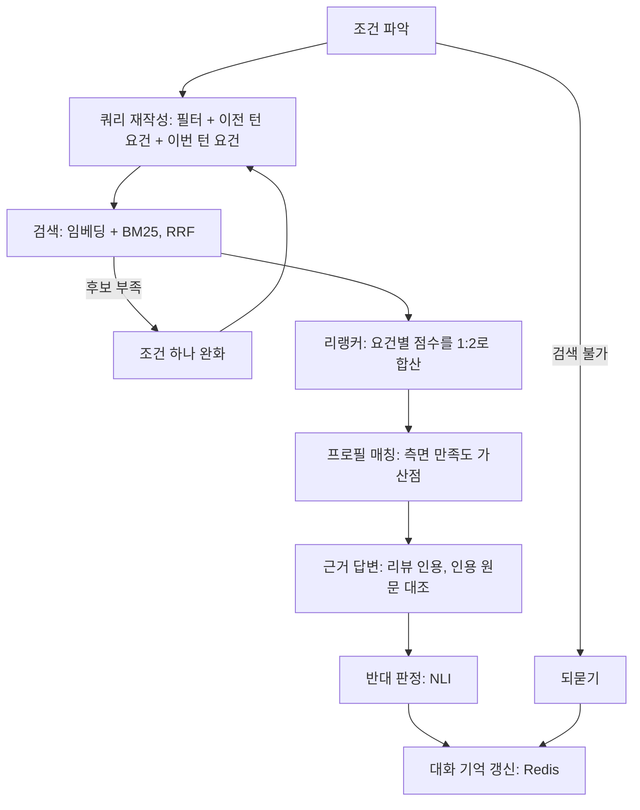

# product-extraction-chatbot



Amazon 옷 리뷰를 근거로 답하는 쇼핑 상담 챗봇입니다. 상품 정보와 리뷰 내용을 LLM으로 미리 추출해 두고, 대화할 때는 실제 구매자 리뷰를 인용해서 한국어로 답합니다.
LLM은 전부 로컬(RTX 3070 8GB, Ollama의 Qwen3 4B)에서 돌립니다.

이 프로젝트에서 가장 신경 쓴 것은 **작은 로컬 모델의 출력을 그대로 믿지 않는 것**입니다. 모델에게는 정해진 칸을 채우는 일만 맡기고, 판단할 수 있는 것은 코드가 검사합니다.

> 진행 중인 프로젝트입니다. 옷(Amazon Fashion) 도메인으로 처음부터 끝까지 돌아가는 상태이고, 화장품 도메인과 Kafka 스트리밍은 다음 단계입니다.

## 대화 예시

아래 답은 자동 점검(`scripts.check_all`)에서 실제로 나온 것입니다.

**1턴: "추위 많이 타는데 검은 털옷 추천해줘"**
조건(옷, 검은색, 털 소재, 아우터 종류)을 파악해서 리뷰를 찾고, 상품마다 리뷰를 인용해 답합니다.

```
[상품 1] [R1] 추운 날씨에 매우 적합하며, 따뜻하게 유지해 줍니다. [R2] 길고 따뜻하며, 추운 겨울 아침에 매우 좋습니다.
```

**2턴: "그 중에 털 안 빠지는 걸로"**
이전 조건은 이어 가면서 다시 찾고, 털이 빠진다는 리뷰가 있는 상품은 빼고 근거를 보여 줍니다.

```
'털 안 빠지는 걸로' 조건과 반대되는 리뷰가 있는 상품은 뺐어요 ([R4]). 보여드린 상품에는 반대되는 리뷰가 없었어요.
```

[R4]는 "gray lining of the hood rubs off and I find gray fuzz everywhere"(후드 안감 보풀이 사방에 묻어요)입니다.

**3턴: "2번 사이즈는 어때?"** 바로 앞 화면의 2번 상품에 대해서만 답합니다.
**4턴: "회색으로 다시 보여줘"** 색 조건만 바꾸고 나머지 요구는 유지한 채 다시 찾습니다.

화면에서 [R1] 같은 번호를 누르면 그 리뷰 원문이 옆에 나옵니다.

## 구조



챗봇은 한 턴을 이렇게 처리합니다.



| 구성 | 사용한 것 |
|---|---|
| LLM | Qwen3 4B 8비트 (Ollama, GPU) |
| 임베딩 | bge-small-en-v1.5 (CPU) |
| 리랭커 | bge-reranker-base (CPU) |
| 반대 판정 | DeBERTa-v3-large NLI (MoritzLaurer/DeBERTa-v3-large-mnli-fever-anli-ling-wanli, CPU) |
| 검색 | Qdrant + BM25, RRF로 결합 |
| 대화 흐름, 기억 | LangGraph, Redis |
| 서버, 화면 | FastAPI, HTML |
| 실행 환경 | Docker Compose |

## 원칙: 모델은 칸을 채우고, 코드가 검사한다

작은 모델은 규칙을 말해 줘도 놓칩니다. 그래서 단계마다 모델이 할 일과 코드가 할 일을 나눴습니다.

| 단계 | 모델이 하는 일 | 코드가 하는 일 |
|---|---|---|
| 상품 정보 추출 | 선택지 중에서 고르기 | 원문에 근거 단어가 없는 값 삭제 |
| 리뷰 측면 추출 | 측면, 평가, 인용 구절 쓰기 | 인용 구절이 리뷰에 없으면 삭제 |
| 조건 파악 | 바꿀 조건 고르기, 영어 검색어, 새로 원하는 점과 그 근거 구절 | 조건 병합과 값 검증, "털옷", "2번" 같은 단어 규칙, 근거 구절이 메시지에서 왔는지 확인 |
| 검색 순위 | 없음 | 이전 턴과 이번 턴 요건을 나눠 1:2로 합산, 측면 만족도 가산점 (리뷰가 적으면 작게) |
| 답변 | 상품마다 리뷰 번호, 영어 원문 구절, 한국어 문장 | 구절이 그 상품의 그 리뷰 원문에 있을 때만 문장을 남김, 숫자 결론은 코드가 씀 |
| 반대 판정 | 피하고 싶은 문제를 영어 문장으로 옮기기 | 한국어 부정을 떼어 냄, NLI로 판정, 결론 문장 작성 |

구조화 출력의 모든 칸은 필수로 두고(기본값이 있으면 Ollama가 건너뜀), 목록에는 최대 개수를 정합니다(없으면 같은 값을 수백 번 반복함). 답변의 상품 목록은 최소 개수도 상품 수로 정해서 모델이 상품을 건너뛰지 못하게 합니다. Ollama 구조화 출력은 llama.cpp 문법(GBNF)으로 바뀌고, 이 변환이 JSON 스키마의 minItems, maxItems를 지킵니다.

## 데이터

Amazon Reviews 2023의 Amazon_Fashion 카테고리를 씁니다. 상품 카테고리 정보가 100% 비어 있어서, 제목 단어(jacket, coat, fleece, sweater, hoodie 등)로 아우터와 니트류를 골랐습니다.

| 단계 | 개수 |
|---|---|
| 전체 상품 | 826,108 |
| 제목 단어 필터 통과 | 79,030 |
| 구매 인증 리뷰 10개 이상 | 1,462 |
| 옷이 아닌 상품 제외 후 (종류 other 231개, 가운 숄 코스튬 발라클라바 등 제목 단어 141개) | 1,091 |
| 리뷰 (상품당 최대 20개, 중복 제거) | 22,398 |
| 리뷰 측면 (인용 확인 후) | 37,717개 저장, 3,386개(8%) 제외 |
| 검색 항목 (리뷰 + 측면) | 51,855 |

리뷰 측면 추출은 Qwen3 4B로 7시간 반 걸렸고, 4,479묶음 중 실패는 1개였습니다.

## 추출 품질을 높인 과정

정확도는 상품 10개를 원문과 대조해 직접 채점한 결과입니다. 정답 라벨로 하는 정식 평가는 다음 단계입니다.

1. **모델이 선택지를 못 보고 있었다.** 구조화 출력은 형식만 강제하고 고를 수 있는 값을 모델에게 보여 주지 않아서, 카디건을 pants로 채웠습니다. 칸마다 선택지와 규칙을 프롬프트에 직접 적었습니다.
2. **모델 크기.** Qwen3 1.7B(16비트)는 종류 8/10, 4B(8비트)는 10/10이었습니다. 1.7B는 정밀도를 올려도 같은 오답을 내서 크기의 한계로 봤고, 8GB GPU에 맞게 4B 8비트를 골랐습니다.
3. **목록 칸이 전부 비어 있었다.** 기본값이 있는 칸을 Ollama가 건너뛰어 "없다고 답한 것"처럼 보였습니다. 모든 칸을 필수로 바꿨습니다.
4. **같은 값을 수백 번 반복했다.** polyester를 252번 쓰다 잘리는 경우가 있어 목록 최대 개수를 넣었습니다.
5. **원문에 없는 값.** 값마다 원문에 나와야 할 단어(gray는 gray, grey, charcoal 등)를 설정에 적고, 하나도 없으면 버립니다. 리뷰 측면은 인용 구절이 리뷰에 없으면 버리고, 이 단계에서 8%가 걸러졌습니다.

이 과정을 거친 뒤 10개 상품의 남은 오류는 칸 1~2개 수준입니다.

## 답변을 믿을 수 있게 만든 과정

### 인용 먼저

처음에는 모델이 문장을 쓰고 리뷰 번호만 붙였고, 코드는 번호가 그 상품의 리뷰인지만 확인했습니다. 그래서 "[R1] 털 안 빠진다고 하네요" 같은 문장이 R1에 털 얘기가 전혀 없어도 통과했습니다.

지금은 상품마다 **리뷰 번호, 그 리뷰의 영어 원문 구절, 그 구절만 근거로 쓴 한국어 문장** 순서로 칸을 채웁니다. 문법 기반 디코딩은 칸 순서대로 생성하므로 구절을 먼저 고른 뒤 문장을 쓰게 되고, 코드는 구절이 그 리뷰 원문에 실제로 있을 때만 문장을 남깁니다. 같은 4턴 대화로 비교했을 때 근거 18개 중 17개가 원문 대조를 통과했고, 다른 상품의 리뷰를 댄 1개가 걸러졌습니다. 답변 단계는 턴마다 1.2~1.9초 늘었습니다(한 번씩 측정).

### 이어지는 질문

"그 중에 ~한 걸로"라고 하면 보여 준 상품 안에서 고르지 않고 다시 찾습니다. 이전 턴 요건(예: 따뜻함)과 이번 턴 요건(예: 털 빠짐)을 리랭커가 따로 채점해서 1:2로 합칩니다. 조건(색, 종류)은 이어지고, 색처럼 필터로 거르는 값은 검색어에서 빼서 "회색으로" 바꾼 뒤 이전 턴의 black이 남지 않게 했습니다.

보온성, 사이즈 같은 측면 8개는 리뷰 측면 추출로 미리 만족도를 집계해 둡니다. 이 만족도는 순위를 덮어쓰지 않고 가산점으로만 더하고, 리뷰 5건분의 중간값(50%)과 섞어서 리뷰 1건짜리 100%가 리뷰 20건짜리 90%를 이기지 못하게 합니다.

### 반대 판정 ("털 안 빠지는 걸로")

리랭커는 "털 빠짐 얘기를 하는가"만 보고 "안 빠진다고 하는가"는 구분하지 못해서, 털이 빠진다는 불만 리뷰가 있는 상품을 오히려 위로 올렸습니다. 이를 고치려고 여러 방법을 같은 평가 세트로 쟀습니다.

평가 세트는 리뷰 구절 145개를 직접 다시 라벨링했습니다(실제 반대 30개, 요구는 털 빠짐과 사이즈 2개, `data/eval/stance_set.json`). 처음에는 리뷰 측면 추출 라벨을 정답으로 썼는데, 배송(shipping)을 털 빠짐(shedding)으로 붙이는 등 엉터리여서 버렸습니다.

| 방법 | 반대 찾음 | 반대라고 한 것 중 진짜 |
|---|---|---|
| 답변 모델이 판정 칸을 고름 | 0/30 | 판정 없음 |
| 단어 규칙 (단어 목록은 LLM이 작성) | 0/30 | 판정 없음 |
| 지시문 리랭커 (Qwen3-Reranker-0.6B, CPU에서 10쌍 20초) | 10/30 | 10/10 |
| **NLI 확정 (채택)** | **10/30** | **10/10** |
| LLM 예/아니오 확률 | 9/30 | 9/12 |
| NLI 또는 확률 | 16/30 | 16/19 |

실험하면서 알게 된 것은 **Qwen이 한국어 개념은 알아듣는데 부정의 방향을 틀린다**는 점입니다. "털 안 빠지는"을 "does not shed"처럼 원하는 쪽으로 옮겨서, 문제 문장이 뒤집혔습니다. 그래서 한국어 부정을 코드가 먼저 떼어 냅니다(털 안 빠지는 → 털 빠지는). 모델은 "This clothing item has a lot of hair falling out." 같은 문장으로 옮기기만 하고, NLI 모델이 근거 구절마다 이 문장이 참(함의)인지 봅니다.

- NLI로 반대가 확정되면 상품을 빼고 근거를 보여 줍니다. 위 평가에서 틀린 확정은 없었습니다.
- LLM 예/아니오 확률로만 반대면 말하지 않고 순위만 내립니다. 틀려도 화면에 틀린 말이 나오지 않습니다.
- 같은 문제 문장을 이번 턴 검색 요건에도 씁니다. 모델에게 바로 영어 검색어를 맡기면 'fur free', 'fur'처럼 실행마다 달랐습니다.

번역 전용 모델(opus-mt-ko-en, NLLB-600M)은 "보풀 안 생기는"을 "I don't want to be left alone"처럼 옮겨서 뺐습니다. 한국어 특화 모델 EXAONE 3.5 7.8B는 이해가 가장 좋았지만 GPU를 7GB 써서 Qwen과 같이 올릴 수 없었습니다. 다시 잴 때는 `scripts.eval_stance`를 씁니다.

## 프롬프트 기법과 근거

| 기법 | 출처 | 구현 |
|---|---|---|
| 모른다고 말하게 허락, 제공한 문서만 쓰게 제한 | Anthropic 문서 (Reduce hallucinations) | 근거 없는 문장을 쓰지 않게 하고 빈 자리는 코드가 집계로 채움 |
| 인용 먼저 뽑고 답하기 | 같은 문서, LLMQuoter (arXiv 2501.05554) | 답변 칸 순서를 원문 구절, 문장 순으로, 구절은 코드가 원문과 대조 |
| 구조화 출력에서 근거 칸을 먼저 | Constraint Tax (arXiv 2605.26128): 작은 모델에 스키마를 강제하면 형식 통과 61.5%→100%, 정답 19.7%→11.0% | 근거 칸을 문장 칸보다 앞에 둠 |
| NLI로 입장 판정 | Yin et al. 2019 (zero-shot 분류) | 가설은 부정 없는 문제 문장으로, 함의만 씀 (원하는 점을 가설로 두면 아무 불만이나 모순으로 봄) |
| 입력을 태그로 구조화 | Anthropic 프롬프트 가이드 | `<rules>`, `<product>`, `<review>`, `<want>` |
| greedy 디코딩 쓰지 않기 | Qwen3 모델 카드 | 온도 0.3, top_p 0.8, top_k 20, seed 고정 |
| 프롬프트 예시는 새어 나온다 | 직접 겪음 | 예시 대신 설정의 단어 목록과 코드 규칙으로 |

## 속도

웹 서버를 예열한 뒤(검색 자원과 NLI 모델을 한 번 올린 뒤) 같은 2턴 대화를 3번 보내 잰 값입니다. 단계별 시간은 서버 로그에 남깁니다.

| 단계 | 1턴 (새 추천) | 2턴 ("그 중에 털 안 빠지는 걸로") |
|---|---|---|
| 조건 파악 (LLM) | 5.8~7.3초 | 5.2~5.7초 (문제 문장 생성 포함) |
| 검색 | 0.2~0.3초 | 0.3초 |
| 리랭커 (CPU) | 2.3~2.8초 | 3.6~4.2초 (요건 2개) |
| 답변 (LLM, 2턴은 반대 판정 포함) | 13.4~15.6초 | 14.9~17.5초 |
| 전체 | 22.3~25.0초 | 24.0~27.2초 |

서버를 띄운 뒤 첫 대화는 모델을 올리느라 더 걸렸습니다(1턴 37.5초, 2턴 29.1초). 답변 단계가 가장 길어서, 스트리밍과 GPU 메모리 조정(지금 모델 일부가 CPU로 밀려 있음)을 다음에 볼 계획입니다.

처리 시간을 줄인 것들입니다.

- NLI 모델은 fp16으로 저장돼 있는데 CPU에서는 fp16이 느려서 float32로 올립니다. 10쌍에 4.8초에서 1.3초로 줄었습니다.
- 리랭커 후보를 25개로 제한하고, 임베딩은 텍스트별로 캐시해서 인덱스를 다시 만들 때 새 텍스트만 계산합니다.
- 추출 결과를 한 건씩 바로 파일에 쓰고, 다시 실행하면 끝난 것은 건너뜁니다.

## 점검과 평가

```bash
docker compose run --rm app python -m scripts.check_all --quick   # 설정, 단위 테스트, 인덱스 (몇 초)
docker compose run --rm app python -m scripts.check_all           # 위 + 실제 4턴 대화 (2~3분)
docker compose run --rm app python -m scripts.eval_stance         # 반대 판정 평가
```

`check_all`의 대화 점검은 답의 형식(같은 문장 반복, 영어 섞임)과 대화 동작(조건이 이어지는지, 이번 턴 요구가 검색에 들어가는지, 번호가 앞 화면을 가리키는지, 바꾼 색이 이전 색을 지우는지)을 확인합니다.

## 실행

Docker Desktop과 NVIDIA 드라이버가 필요합니다.

```bash
cp .env.example .env               # Windows는 copy .env.example .env
docker compose up -d --build
docker compose exec ollama ollama pull qwen3:4b-q8_0
```

원본 데이터(jsonl)는 `data/raw`에 둡니다.

```bash
# 데이터 확인과 전처리
docker compose run --rm app python -m scripts.peek_categories --domain clothing
docker compose run --rm app python -m src.ingest.prepare --domain clothing

# 추출 (점검 → 전체)
docker compose run --rm app python -m scripts.llm_smoke_test --domain clothing --n 10
docker compose run --rm app python -m src.extract.product_attrs --domain clothing
docker compose run --rm app python -m src.extract.review_aspects --domain clothing

# 인덱스, 서버 재시작
docker compose run --rm app python -m src.index.build_index --domain clothing
docker compose restart app
```

브라우저에서 http://localhost:8000 을 엽니다.

| 바꾼 것 | 반영 |
|---|---|
| `src`, `configs` | `docker compose restart app` |
| `.env`, `docker-compose.yml` | `docker compose up -d` |
| `requirements.txt`, `Dockerfile` | `docker compose up -d --build` |

## 폴더

```
configs/        도메인별 설정 (속성 스키마, 근거 단어, 측면, 필터, 한국어 단어 매핑)
src/ingest/     전처리
src/extract/    상품 정보 추출, 리뷰 측면 추출, 정확도 평가
src/index/      임베딩 캐시, Qdrant, BM25, 상품 속성표
src/retrieval/  하이브리드 검색, 리랭커
src/agent/      LangGraph 그래프, 노드, 조건 병합, 반대 판정
src/store/      Redis 세션, 이벤트 기록
src/api/        FastAPI, 웹 화면
scripts/        카테고리 확인, LLM 점검, 터미널 대화, 전체 점검, 반대 판정 평가
tests/          조건 병합, 순위, 답변 검사, 한국어 부정 처리
data/eval/      반대 판정 평가 세트
```

## 한계와 다음 단계

- 반대 판정 평가 세트가 작습니다 (요구 2개, 반대 30개). "안 비치는"은 Qwen이 'bright'로 옮겨서 틀립니다.
- 답 문장은 인용 구절이 원문에 있는지까지 확인하지만, 구절을 한국어로 옮긴 뜻이 맞는지는 확인하지 못합니다 ('pet hair MAGNET'을 '털이 빠지기 쉬움'으로 옮긴 경우가 있었음).
- 한 턴이 22~27초 걸립니다.

- [ ] 반대 판정 평가 세트 키우기, 답 문장 뜻 검사
- [ ] 답변 스트리밍, GPU 메모리 조정으로 한 턴 15초 이내
- [ ] 상품 정보 추출 정식 평가 (정답 라벨 50개로 속성별 정확도)
- [ ] RAG 평가 질문 세트로 바꿀 때마다 같은 질문 비교
- [ ] 화장품 도메인 추가
- [ ] Kafka: 새 리뷰가 들어오면 그 리뷰만 추출, 임베딩, 저장
- [ ] MLflow에 프롬프트, 모델 버전과 평가 지표 기록
